# CINEFLIX

Aplikasi katalog film untuk Android dan iOS, dibangun pakai Flutter. Tampilannya gelap dengan aksen merah, isinya kumpulan film lengkap dengan poster, rating, sinopsis, dan daftar tontonan pribadi.

CINEFLIX dibuat untuk kamu yang sering bingung mau nonton apa. Semua judul sudah dikelompokkan, jadi tinggal geser, lihat detail, lalu simpan yang menarik ke daftar.

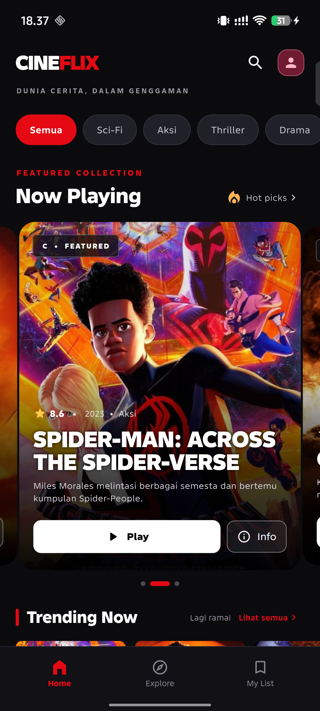

## Yang bisa dilakukan di aplikasi

**Menjelajah katalog**
Beranda menampilkan banner **Now Playing** yang berganti sendiri tiap lima detik, lalu deretan **Trending Now**, **Popular**, **Top Rated**, dan **Top 10 Pilihan**. Semua bisa digeser ke samping.

**Menyaring dan mencari**
Ada chip kategori (Semua, Sci-Fi, Aksi, Thriller, Drama, Animasi) yang langsung menyaring seluruh katalog. Tombol pencarian di kanan atas mencari judul atau genre tanpa pindah halaman.

**Membuka halaman koleksi**
Tulisan **Hot picks** dan tautan **Lihat semua** di setiap section membuka halaman berisi daftar film section itu saja, lengkap dengan jumlah filmnya.

**Melihat detail film**
Ketuk poster mana pun, muncul panel detail berisi tahun, genre, durasi, rating, dan sinopsis. Dari situ film bisa diputar (dalam mode demo) atau disimpan.

**Menyimpan ke My List**
Tombol **Daftarku** menambahkan film ke tab **My List**. Ikon bookmark di bawah langsung menampilkan angka, jadi kelihatan berapa film yang sudah disimpan.

**Profil dan pengaturan**
Ikon profil di kanan atas membuka halaman profil berisi statistik singkat dan pengaturan: kualitas streaming, notifikasi, bahasa, halaman Tentang aplikasi, serta tombol keluar.

## Tampilan tiap halaman

### Animasi pembuka

Saat pertama dibuka, logo CINEFLIX muncul dengan glow merah dan sapuan cahaya, lalu memudar membuka beranda.

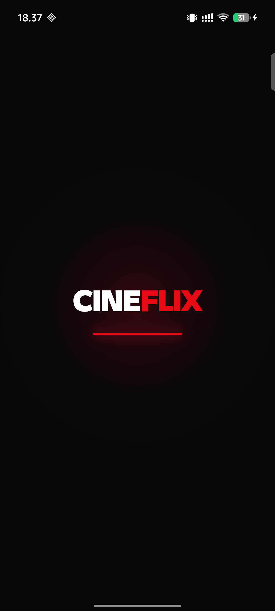

### Beranda

Banner Now Playing, chip kategori, dan deretan film. Angka pada indikator menunjukkan posisi banner.


### Filter kategori

Pilih kategori, seluruh section ikut menyesuaikan.

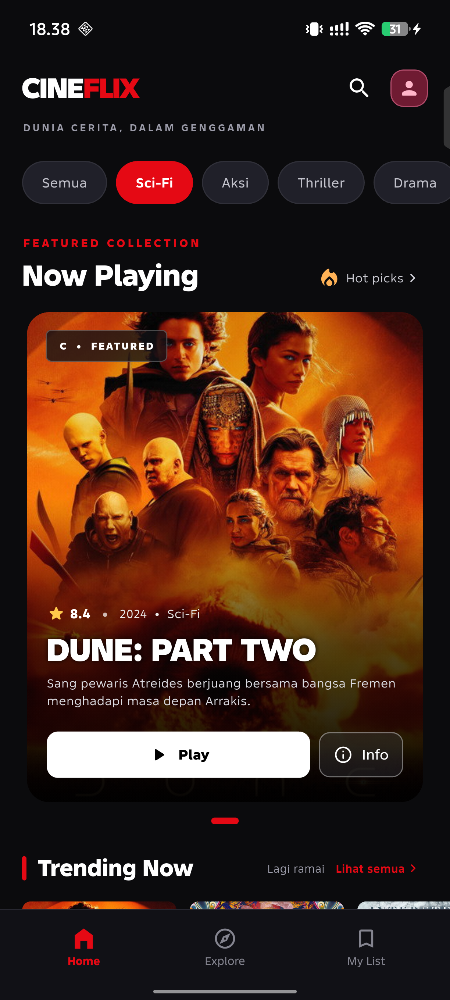

### Halaman koleksi

Dibuka dari **Hot picks** atau **Lihat semua**. Isinya hanya film dari section tersebut.

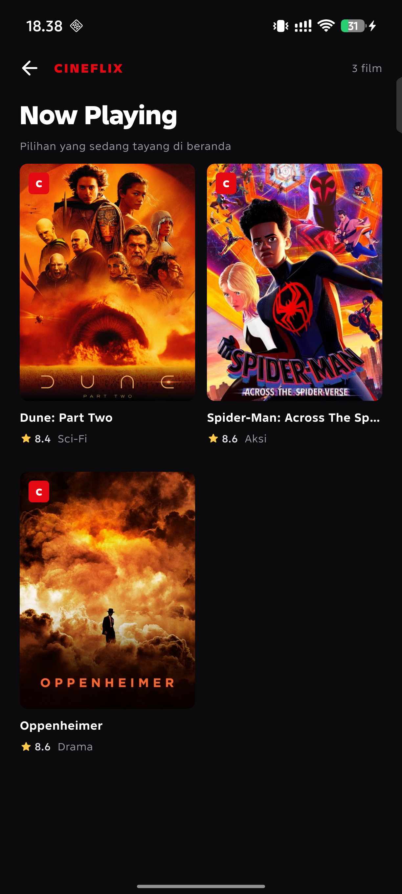

### Detail film

Panel bawah berisi poster, tahun, genre, durasi, rating, sinopsis, tombol **Putar Film** dan **Daftarku**.

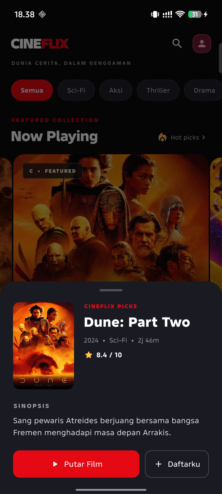

### Setelah disimpan

Tombol berubah jadi **Tersimpan** dengan tanda centang.

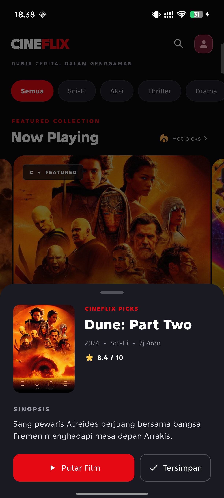

### Pemutar film

Menekan Play membuka halaman pemutar. Karena belum ada layanan streaming, muncul pesan bahwa video gagal diputar.

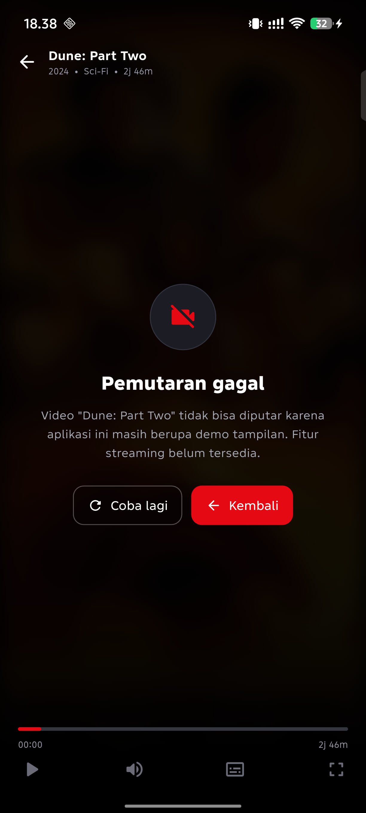

### Explore

Tab Explore menampilkan seluruh katalog dalam bentuk grid, plus kolom pencarian dan filter kategori.

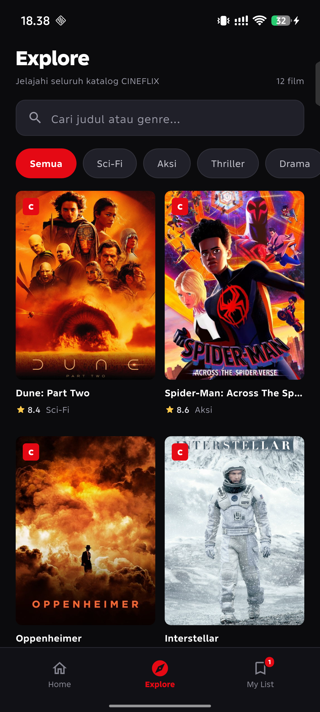

### Pencarian

Ketik judul atau genre, hasilnya langsung menyempit. Jumlah film muncul di kanan atas.

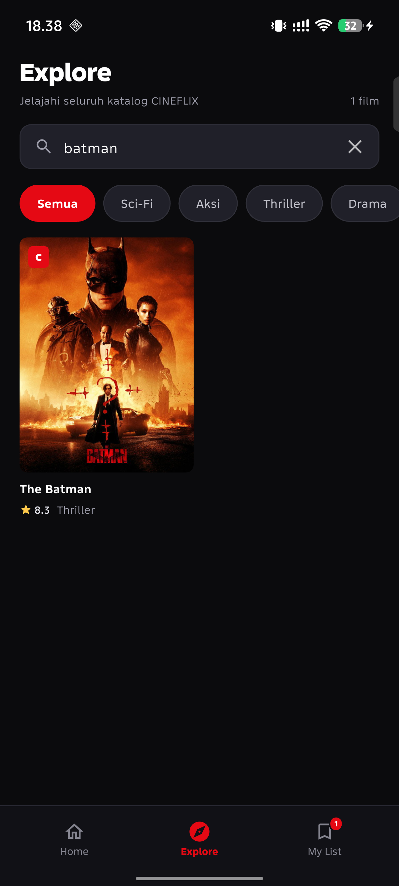

### My List

Semua film yang ditandai Daftarku berkumpul di sini. Kalau masih kosong, ada tombol untuk langsung ke katalog.

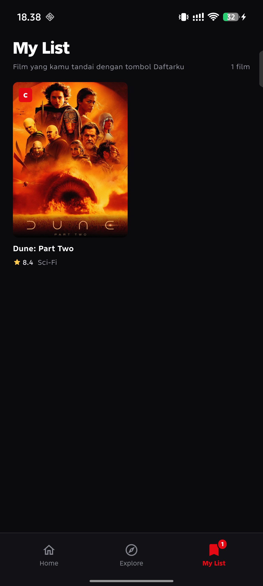

### Profil

Statistik simpanan dan semua pengaturan dalam satu halaman.

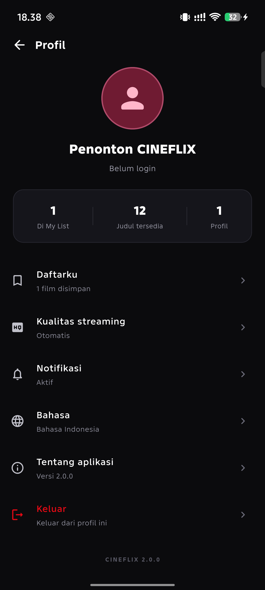

### Tentang aplikasi

Penjelasan singkat tentang CINEFLIX, fitur utamanya, sumber poster, dan kredit.

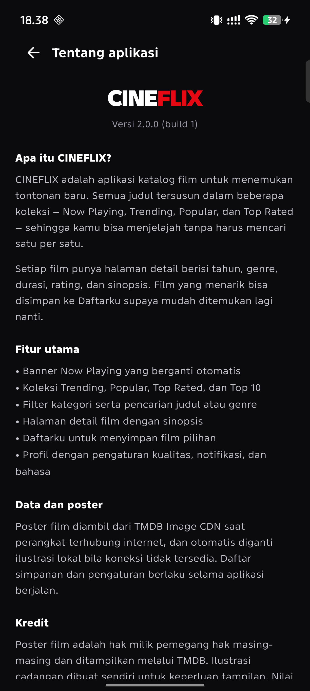

### Tanpa internet

Poster daring otomatis diganti ilustrasi lokal, jadi tampilan tetap utuh saat koneksi mati.

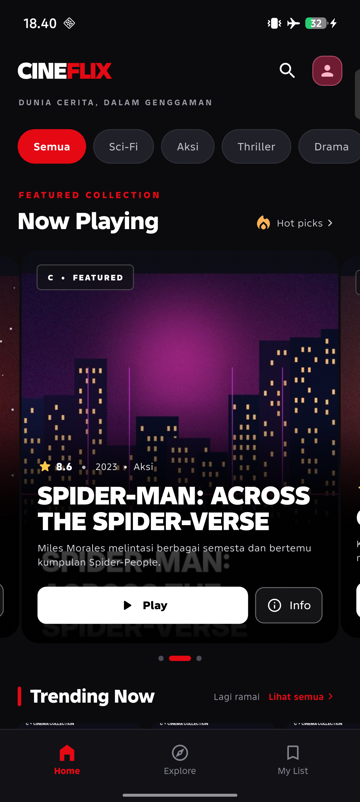

## Rekaman demo

Ada rekaman singkat pemakaian aplikasi di HP: `docs/cineflix_demo.mp4`.

## Menjalankan aplikasi

Butuh Flutter 3.47 atau lebih baru dan Android Studio (untuk Android SDK).

```bash
flutter pub get
flutter run
```

Untuk melihat daftar perangkat yang siap dipakai:

```bash
flutter devices
```

Kalau ingin langsung memasang versi rilis ke HP:

```bash
flutter build apk --release
adb install -r build/app/outputs/flutter-apk/app-release.apk
```

Panduan lebih lengkap — termasuk VS Code, Android Studio, pengaturan HP, dan perbaikan kalau perangkat tidak terdeteksi — ada di [CARA_MENJALANKAN.md](CARA_MENJALANKAN.md).

### Catatan iOS

Folder `ios/` sudah siap, tapi build iOS hanya bisa dilakukan di macOS dengan Xcode:

```bash
flutter pub get
open ios/Runner.xcworkspace
```

## Susunan folder

```text
lib/
  main.dart
  models/movie.dart
  data/movie_catalog.dart
  screens/
    app_shell.dart        navigasi bawah, animasi pembuka, penyimpanan My List
    home_screen.dart      beranda katalog
    explore_screen.dart   grid katalog dengan pencarian
    my_list_screen.dart   daftar film tersimpan
    collection_screen.dart halaman koleksi per section
    player_screen.dart    halaman pemutar
    profile_screen.dart   profil dan pengaturan
  widgets/
    cineflix_intro.dart      animasi pembuka
    cineflix_bottom_bar.dart navigasi bawah
    movie_detail_sheet.dart  panel detail film
    movie_grid.dart          grid poster
    movie_artwork.dart       poster daring + cadangan lokal
    movie_poster_card.dart   kartu poster dan section
assets/
  offline_posters/  12 ilustrasi lokal untuk mode offline
  posters/          bahan ilustrasi
  featured/         bahan ilustrasi
docs/              screenshot dan rekaman demo
tools/             skrip bantuan (perbaikan driver ADB di Windows)
```

## Cara kerja singkat

- State film tersimpan dan tab aktif dipegang oleh `AppShell`, jadi semua halaman selalu melihat data yang sama.
- Poster diambil dari TMDB Image CDN `https://image.tmdb.org/t/p/w500/...` tanpa API key. Kalau gagal dimuat, ilustrasi lokal langsung dipakai.
- Data film masih statis di `lib/data/movie_catalog.dart`. Rating di dalamnya contoh, bukan skor real-time.
- Animasi pembuka hanya muncul sekali per peluncuran dan otomatis dilewati bila pengaturan aksesibilitas perangkat mematikan animasi.

## Kredit

Poster film adalah milik pemegang haknya masing-masing dan ditampilkan lewat TMDB. Ilustrasi cadangan dibuat sendiri untuk keperluan tampilan. Proyek ini tidak berafiliasi dengan Netflix maupun TMDB.
